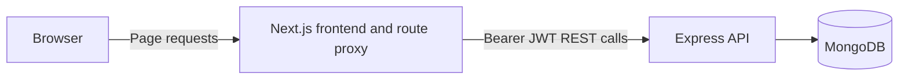

# Doctor Tracker

## Elevator Pitch

Doctor Tracker is a small, admin-only portal for managing doctors and their patients. This root repository contains the Compose configuration that connects the separately maintained [backend](https://github.com/HafijurRahmanBhuiyan/doctor-tracker-backend) and [frontend](https://github.com/HafijurRahmanBhuiyan/doctor-tracker-frontend) repositories.

**Live demo**

- Frontend: https://doctor-tracker-frontend-iota.vercel.app
- Backend: https://doctor-tracker-api-3je6.onrender.com/api/v1/health
- Frontend repository: [doctor-tracker-frontend](https://github.com/HafijurRahmanBhuiyan/doctor-tracker-frontend)
- Backend repository: [doctor-tracker-backend](https://github.com/HafijurRahmanBhuiyan/doctor-tracker-backend)
- Root repository: [doctor-tracker](https://github.com/HafijurRahmanBhuiyan/doctor-tracker)

## Setup Guide

Clone the three repositories side by side so the application repositories are named `backend/` and `frontend/` beneath the root checkout. Then run the single startup command from the root:

```bash
git clone https://github.com/HafijurRahmanBhuiyan/doctor-tracker.git doctor-tracker
cd doctor-tracker
git clone https://github.com/HafijurRahmanBhuiyan/doctor-tracker-backend.git backend
git clone https://github.com/HafijurRahmanBhuiyan/doctor-tracker-frontend.git frontend
docker compose up --build
```

Compose uses defaults when no root `.env` file exists. To customize them, copy [`.env.example`](.env.example) to `.env` first. Change `JWT_SECRET` before using a real deployment.

Open [http://localhost:3000](http://localhost:3000) and sign in with `admin@doctortracker.com` / `Admin@12345` for the default local setup. The API is at [http://localhost:5001/api/v1](http://localhost:5001/api/v1). macOS commonly reserves host port 5000 for AirPlay, so Compose publishes the backend on host port 5001 while the container listens on 5000.

| Container | Role | Host access |
| --- | --- | --- |
| `mongo` | MongoDB database and persistent named data volume | Not published |
| `backend` | Express REST API and startup seeding | `localhost:5001` → container port 5000 |
| `frontend` | Next.js standalone web application | `localhost:3000` → container port 3000 |

Stop containers with `docker compose down`. To also delete the MongoDB volume and all local database data, use `docker compose down -v`.

## System Architecture



The frontend protects admin routes using the `dt_token` cookie and calls the backend at `/api/v1`; MongoDB is reachable only inside the Compose network. The API returns paginated resources and dashboard aggregates. Compose publishes only frontend port 3000 and API port 5001.

## Technical Decisions

### 1. Indexed word-prefix search and aggregation-based analytics

- **Problem:** Search and dashboard queries need to remain practical as records grow.
- **Options considered:** Substring regex/text search versus indexed tokens; per-patient joins versus grouping first.
- **Decision:** The backend maintains indexed `searchTokens`, uses word-prefix matching, compound indexes, and aggregates dashboard counts in MongoDB.
- **Trade-offs:** Mid-word substring search is intentionally not supported; token and index maintenance add write work.
- **Evidence:** The isolated 500-doctor/30,000-patient explain run had zero flagged of 30 shapes; list queries used IXSCAN at 0–7 ms. The specialization aggregation improved from 375 ms to 17 ms after grouping by doctor first. Details and reproduction scripts are in the [backend README](https://github.com/HafijurRahmanBhuiyan/doctor-tracker-backend#technical-decisions).

### 2. URL state plus TanStack Query

- **Problem:** List views should be shareable and survive reloads without duplicating server state in a global store.
- **Options considered:** Redux/Context for all state versus query-string controls and a server-state cache.
- **Decision:** The frontend stores list state in the URL and API results in TanStack Query, with previous data retained during list changes and affected query keys invalidated after mutations.
- **Trade-offs:** URL parsing/default handling and hydration require care; patient writes refetch invalidated data, while doctor-detail patient add/remove uses optimistic updates.
- **Evidence:** `useUrlState`, the query-key factory, and the doctor/patient hooks implement this flow; details are in the [frontend README](https://github.com/HafijurRahmanBhuiyan/doctor-tracker-frontend#technical-decisions).

## Visual Evidence

### Desktop

See the desktop screenshots in the [backend README](https://github.com/HafijurRahmanBhuiyan/doctor-tracker-backend#visual-evidence) and [frontend README](https://github.com/HafijurRahmanBhuiyan/doctor-tracker-frontend#visual-evidence), including login, dashboard top and lower charts, doctor list/detail, patient list, and dashboard dark mode.

### Mobile

The app READMEs include mobile dashboard, doctor list, and patient list screenshots: [backend visuals](https://github.com/HafijurRahmanBhuiyan/doctor-tracker-backend#visual-evidence) and [frontend visuals](https://github.com/HafijurRahmanBhuiyan/doctor-tracker-frontend#visual-evidence).

